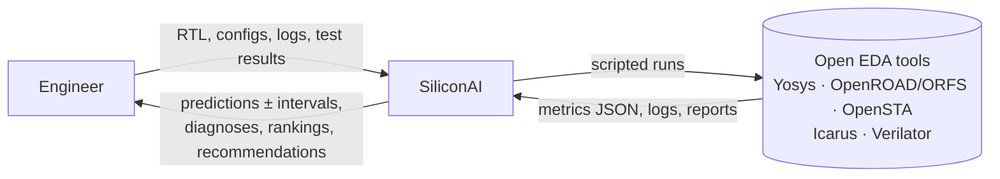
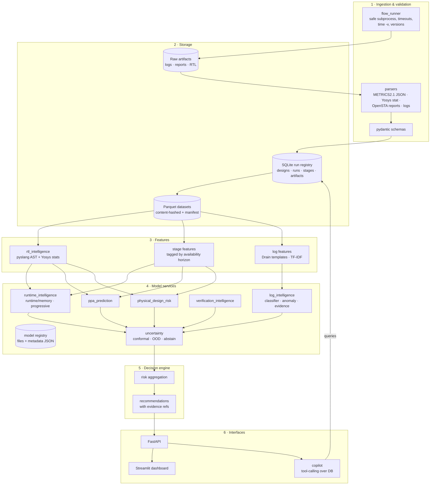
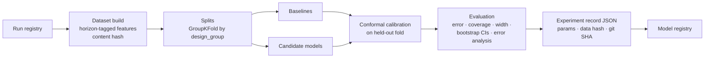

# SiliconAI — Architecture (proposed)

**Status:** design only. Nothing here is implemented yet. Components are created in the phase that
needs them (no empty placeholder folders).

## 1. Principles

1. **Modular monolith.** One Python package, with clear internal boundaries. Split into services
   only for a measured reason.
2. **Data engine first.** Every model is downstream of a reproducible run registry.
3. **Leakage-safe by construction.** Every feature is tagged with the stage at which it becomes
   available. Models declare a horizon.
4. **Predictions carry uncertainty.** Every prediction object includes an interval (or
   a probability) and an `abstain` flag.
5. **Evidence is a first-class type.** Diagnostics and recommendations reference run IDs,
   metric rows or log line numbers.
6. **Untrusted inputs.** RTL and logs are data. We never execute uploaded scripts. Tools run
   through a hardened subprocess wrapper.

## 2. System context



## 3. Layered component view



## 4. Core data model (SQLite, implemented in Phase 1: `src/siliconai/data/registry.py`)

| Table | Key columns |
|---|---|
| `designs` | design_id, name, platform, origin (`orfs`/`generated`/`external`), source, design_group, license |
| `runs` | run_id, design_id, config_json, config_hash, tool_image (digest), host_json, concurrency, repeat_index, injected_fault (nullable), status, exit_code, wall_s, started_at |
| `steps` | run_id, step (ORFS step, e.g. `3_3_place_gp`), stage (`synth`/`floorplan`/`place`/`cts`/`route`/`finish`/`other`), wall_s, cpu_user_s, cpu_sys_s, peak_rss_mb, metrics_json (METRICS2.1 keys), log_path |
| `log_events` | run_id, stage, line_no, template_id, severity, text_hash |
| `predictions` | pred_id, model_id, run_id, target, horizon, point, lo, hi, abstain, created_at |
| `models` | model_id, task, algo, params_json, dataset_hash, git_sha, metrics_json |

## 5. ML workflow



## 6. Proposed package layout (grows phase by phase)

```
src/siliconai/
  config.py, logging.py            # Phase 1
  eda/        runner.py, orfs.py, yosys.py, metrics.py     # Phase 1–2
  data/       registry.py (SQLite), datasets.py (Parquet), schemas.py
  features/   stage_features.py, horizons.py
  runtime_intelligence/            # Phase 2
  uncertainty/ conformal.py, ood.py
  log_intelligence/                # Phase 3
  rtl_intelligence/                # Phase 4
  ppa_prediction/                  # Phase 5
  verification_intelligence/       # Phase 6
  physical_design_risk/            # Phase 7
  decision/                        # Phase 8
  copilot/                         # Phase 9
api/  dashboard/  scripts/  tests/  docs/  research/
```

This differs from the brainstorm layout in a few places. Those changes are recorded as ADRs: the shared
`eda/`, `data/` and `uncertainty/` packages replace per-module duplication.

## 7. Security model

- Uploads: an extension and size allowlist (`.v`, `.sv`, `.svh`, `.vh`, `.log`, `.rpt`, `.json`,
  `.csv`; size cap), stored under random IDs, never executed.
- Tool execution: `subprocess.run([...], shell=False, timeout=…)`, working dir
  sandboxed per run, resource limits (`ulimit`/`prlimit`), no user-supplied Tcl.
- Configs: validated against an allowlisted parameter schema before being written into
  ORFS config files.
- Secrets: environment variables only; `.env.example` committed, `.env` git-ignored.
- API: generic error messages; details in server logs.

## 8. Risk register

| ID | Risk | Likelihood | Impact | Mitigation | Owner phase |
|---|---|---|---|---|---|
| K1 | OpenROAD not installable in cloud container | Med | High | Source build / prebuilt / your machine | 1 |
| K2 | Compute budget for D1 too large | Med | High | Pilot first; staged sweeps; small designs | 1–2 |
| K3 | Runtime label noise / contention | High | Med | Fixed concurrency; repeats; noise floor | 2 |
| K4 | Few unique designs | High | Med | Generators; CIs; explicit scope | 2 |
| K5 | Leakage via config or near-duplicate designs | Med | High | design_group hashing; leakage tests | 2 |
| K6 | Hidden prior work weakens novelty | Med | Med | Systematic search (P0-R2) | 0/2 |
| K7 | Injected faults unrealistic | High | Med | State limitation; diversify variants | 3 |
| K8 | Python 3.13 wheel gaps (SHAP, pyslang) | Low | Low | Pin 3.12 if needed | 1 |
| K9 | Scope creep | High | High | Phase gates; portfolio cut after Phase 3 | all |
| K10 | LLM cost / hallucination | Med | Med | Last; structured evidence; optional | 9 |
